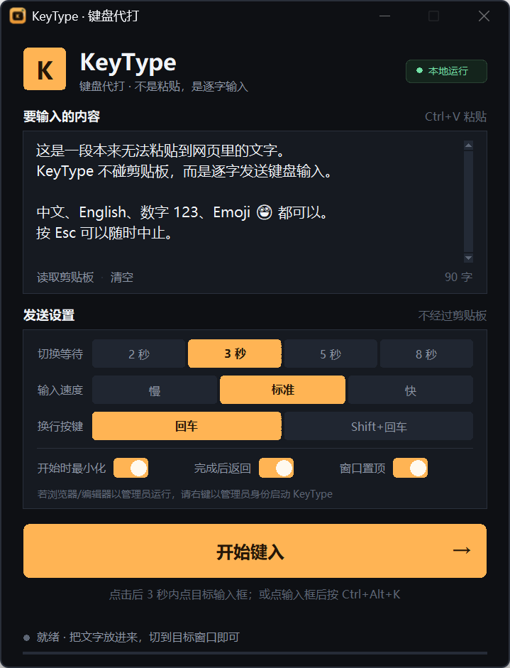
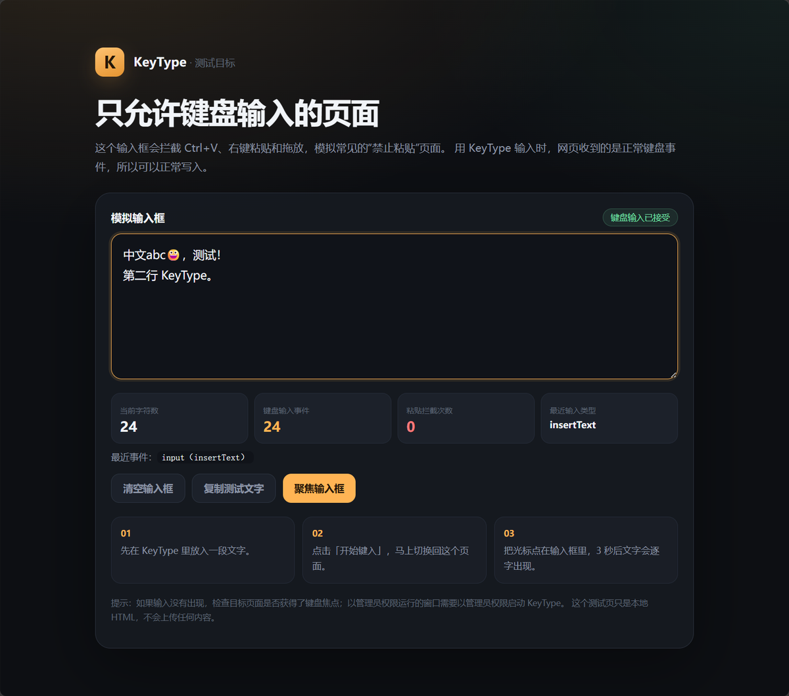

# KeyType · 键盘代打

> 不是粘贴，是像键盘一样逐字敲进去。  
> 专治只允许键盘输入、拦截 Ctrl+V 的网页输入框。


KeyType 是一个 Windows 小工具：把文字放进窗口，点击「开始键入」，切到目标页面，它就会调用 Windows 的 `SendInput`，把内容以**真实键盘输入**逐字发送给当前获得焦点的输入框。

网页收到的会是一连串正常的键盘/文本输入事件，而不是 `paste`、`insertFromPaste` 或 `insertFromDrop`，所以不会触发常见的“禁止粘贴”逻辑。

> A tiny Windows utility that types text into the focused input as real keyboard input. Useful for forms and web editors that block paste.



## 目录

- [特点](#特点)
- [下载与运行](#下载与运行)
- [使用步骤](#使用步骤)
- [权限说明（重点）](#权限说明重点)
- [设置说明](#设置说明)
- [演示页](#演示页)
- [为什么它能绕过粘贴限制](#为什么它能绕过粘贴限制)
- [构建](#构建)
- [项目结构](#项目结构)
- [常见问题](#常见问题)
- [数据与隐私](#数据与隐私)
- [使用边界](#使用边界)

## 特点

- 不修改剪贴板，不注入页面脚本，不依赖浏览器插件
- 支持中文、English、数字、Emoji 和多行文本
- 2 / 3 / 5 / 8 秒切换等待，慢 / 标准 / 快三档输入速度
- 支持「回车」和「Shift+回车」两种换行方式
- 全局热键 `Ctrl+Alt+K`，在目标页面直接开始
- 倒计时与输入进度浮层，`Esc` 随时中止
- 自动检测目标窗口权限，权限不足时明确提示
- 单实例运行，避免全局热键冲突
- 纯本地运行，不联网；设置只保存在本机

## 下载与运行

### 方式一：使用发布包

在仓库的 **Releases** 中下载 `KeyType-1.0.0-win64.zip`，解压后运行：

```text
KeyType.exe
```

如果目标浏览器/编辑器以管理员权限运行，请使用压缩包里的：

```text
以管理员身份启动.cmd
```

> 不要把 `KeyType.exe` 单独复制出来，它依赖同目录下的 `_internal` 文件夹。

### 方式二：源码运行

环境要求：Windows 10/11、Python 3.10+（需要 tkinter）。

```powershell
python app.py
```

克隆仓库后，也可以双击项目根目录的 `启动 KeyType.cmd`。如果本地还没有打包好的 `dist`，它会自动回退到 Python 源码。

> exe 未做代码签名，Windows SmartScreen 可能提示“未知发布者”。可以选择「更多信息 → 仍要运行」，或者使用 Python 源码运行。

## 使用步骤

1. 把要输入的文字放进 KeyType 的文本框。可以直接 `Ctrl+V` 粘贴到 KeyType 里，也可以点「读取剪贴板」。
2. 按需要设置「切换等待」「输入速度」「换行按键」。
3. 推荐做法：**先用鼠标点进目标输入框**，确认光标在闪，然后按 `Ctrl+Alt+K`。
4. 也可以点击「开始键入」，在倒计时内切换到目标页面，并点进目标输入框。
5. 文字会逐字出现；按 `Esc` 随时中止。

### 全局热键

KeyType 保持运行，在目标页面按：

```text
Ctrl+Alt+K
```

即可开始，不需要切换回 KeyType。代码编辑器、富文本框这类“输入焦点比较挑”的页面，优先推荐这种方式。

## 权限说明（重点）

Windows 有 UIPI（用户界面特权隔离）机制：低权限程序不能向高权限窗口发送键盘事件。表现就是：

- KeyType 显示“完成”
- 目标输入框里却没有字
- 页面看起来毫无反应

常见的高权限目标包括：

- 以管理员身份启动的浏览器
- 某些学习通/考试客户端、在线判题客户端
- 管理员权限下运行的 IDE 或代码编辑器

解决办法是让 KeyType 也以管理员身份运行：

```text
以管理员身份启动 KeyType.cmd
```

或右键 `KeyType.exe` →「以管理员身份运行」。

1.0.0 版本会读取目标窗口的完整性级别；当目标权限更高或无法读取时，会提示：

```text
目标窗口权限更高，请以管理员身份运行 KeyType
```

如果目标窗口是普通权限，使用普通方式启动即可，不必每次都提权。

## 设置说明

| 设置 | 作用 |
| --- | --- |
| 切换等待 | 点击开始后留给你切换窗口的时间：2 / 3 / 5 / 8 秒 |
| 输入速度 | 慢 = 60ms/字，标准 = 20ms/字，快 = 8ms/字 |
| 换行按键 | 「回车」适合多行文本框；「Shift+回车」适合聊天框，避免回车直接发送 |
| 开始时最小化 | 默认开启，避免工具窗口挡住目标页面 |
| 完成后返回 | 输入完成后自动回到 KeyType |
| 窗口置顶 | 让 KeyType 保持在其他窗口上方 |

如果输入速度过快导致某些前端框架丢字，请改用「标准」或「慢」。长文本可以分段发送。

## 演示页

打开：

```text
demo/paste-guard-demo.html
```

这个页面会拦截 `Ctrl+V`、右键粘贴和拖放，并统计：

- 当前字符数
- 键盘输入事件数
- 粘贴拦截次数
- 最近一次输入类型

先尝试在页面里 `Ctrl+V`，会看到拦截提示；再用 KeyType 输入，文字会正常出现，最近输入类型会显示为 `insertText`。



自动键入的实测结果：

- 中文 / English / Emoji / 换行全部写入成功
- 输入事件类型：`insertText`
- 键入过程中粘贴拦截次数：0

另外，在真实的在线判题页面代码编辑器中，以高权限启动 KeyType 后输入 `KeyType-Test-123` 成功，测试文字随后已清空。

## 为什么它能绕过粘贴限制

常见的“禁止粘贴”通常做三件事：

```javascript
textarea.addEventListener('paste', event => event.preventDefault());
textarea.addEventListener('drop', event => event.preventDefault());
textarea.addEventListener('beforeinput', event => {
  if (event.inputType === 'insertFromPaste') event.preventDefault();
});
```

KeyType 不碰剪贴板，也不调用页面的 JavaScript API。它通过 Windows 的
[`SendInput`](https://learn.microsoft.com/windows/win32/api/winuser/nf-winuser-sendinput)
把 Unicode 字符作为键盘事件发送给当前前台窗口。对网页来说，这更像用户真的在敲键盘，而不是在粘贴。

## 构建

需要 Python 3.10+、tkinter、PyInstaller 和 Pillow（Pillow 用于重新生成图标）：

```powershell
python -m pip install -r requirements-dev.txt
.\build.cmd
```

或者：

```powershell
powershell -NoProfile -ExecutionPolicy Bypass -File .\build.ps1
```

产物：

```text
dist\KeyType\KeyType.exe
dist\KeyType-1.0.0-win64.zip
```

`build.ps1` 会：

- 生成图标（如果 `assets/keytype.ico` 不存在）
- 使用 onedir + windowed 模式打包，不弹控制台
- 在发布目录中加入「以管理员身份启动.cmd」
- 生成可直接分发的 zip

`dist/` 默认被 `.gitignore` 忽略，不要把二进制提交进仓库；请作为 GitHub Release 附件上传。维护者发布流程见 [docs/PUBLISHING.md](docs/PUBLISHING.md)。

### GitHub Actions

仓库包含 `.github/workflows/windows-build.yml`：

- push 到 `main`、提交 PR 或手动触发时，在 Windows runner 上构建
- 在 Actions 的 Artifacts 中下载 `KeyType-Windows` 构建产物

## 项目结构

```text
keytype/
├─ app.py                         # 界面、设置、倒计时、输入流程
├─ winapi.py                      # SendInput、热键、权限检测、HUD 窗口
├─ assets/                        # 图标
├─ demo/
│  └─ paste-guard-demo.html       # 禁用粘贴测试页
├─ docs/
│  ├─ screenshot.png
│  ├─ demo.png
│  └─ PUBLISHING.md
├─ tools/
│  └─ make_icon.py                # 图标生成脚本
├─ .github/
│  ├─ workflows/windows-build.yml
│  └─ ISSUE_TEMPLATE/
├─ build.ps1
├─ build.cmd
├─ 启动 KeyType.cmd
├─ 以管理员身份启动 KeyType.cmd
├─ requirements-dev.txt
├─ version_info.txt
├─ CHANGELOG.md
└─ LICENSE
```

## 常见问题

**输入没有出现？**

- 先确认光标在目标输入框里，而不是地址栏或其他窗口
- 如果状态提示“目标窗口权限更高”，使用管理员启动脚本
- 输入过程中不要切换窗口；键盘输入永远发给当前焦点窗口
- 部分网站会用 `maxlength`、格式校验、验证码或自定义逻辑拒绝内容，这属于业务限制，工具无法绕过

**中文需要打开输入法吗？**

不需要。KeyType 直接发送 Unicode，中英文和 Emoji 都不经过输入法候选框。个别很老的控件可能不支持 Emoji。

**回车把消息发出去了？**

把「换行按键」改为 `Shift+回车`。不同网站的行为可能不同，输入前先在一个空输入框里测试。

**为什么完成时间比较久？**

按字计算，默认 20ms/字，1000 字大约需要 20 秒。长文可以适当提高速度，或分段输入。

**杀毒软件报毒？**

PyInstaller 打包的未签名程序偶尔会被误报。你可以用源码运行，或自行执行 `build.cmd` 重新打包；项目没有任何网络请求。

**可以输入到记事本吗？**

可以。记事本是最简单的自测目标：打开记事本，把光标点进去，按 `Ctrl+Alt+K`。如果记事本能输入，说明 KeyType 和热键正常，问题通常在目标页面的焦点或权限。

**需要排查问题？**

可以用诊断模式启动，日志会写到 `%APPDATA%\KeyType\debug.log`（不可写时写到程序目录）：

```powershell
KeyType.exe --debug-log
```

## 数据与隐私

- 不访问网络，没有遥测，也没有自动更新
- 输入的文本和设置默认保存在 `%APPDATA%\KeyType\settings.json`
- 如果这个目录不可写，打包版会回退到程序目录下的 `keytype-settings.json`
- 测试页是本地 HTML 文件，不会上传任何内容
- 如果不想留下草稿，可以在关闭程序前清空文本框

## 使用边界

这个工具用于正常填写你有权填写的表单、文章、工单、评论、代码等内容，也适合无障碍场景。

请不要用它绕过验证码、风控、登录限制，或在未经授权的页面批量灌水；在考试、测评或受监考环境中，请遵守平台规则。网站的业务规则和验证码不在本工具的能力范围内。

## License

[MIT](LICENSE)
